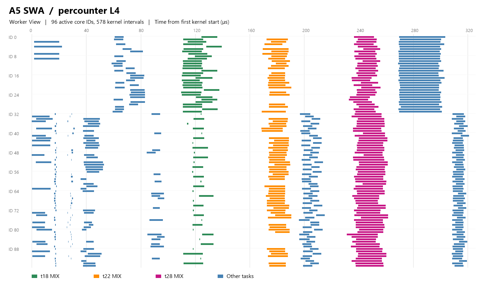

# A5 SWA percounter L4 泳道（2026-11-19）

[完整 Perfetto trace](A5-SWA-percounter-L4.json.gz) · [逐核区间 CSV](kernel-intervals.csv) · [原任务与回放编号对照](source-task-map.txt) · [本轮输出校验](result.json)

在本目录执行 `gzip -dk A5-SWA-percounter-L4.json.gz`，将解压出的 JSON 拖入 Perfetto。Worker View 看 kernel 占用，AICore Scheduler 看每个 worker 的调度、依赖和 MIX 等待，Host Orchestrator 看 Host 编排。CSV 与预览使用原 SWA task ID，起止时间以本轮首个 kernel 开始为零点，单位 µs。编号对照第一列是原 SWA task ID，第二列是回放 ID。

## 黄区对照

先在 A6 trace 中用本次回放的映射表找到同一个原始任务。下表两端点取该任务所有 kernel 的最早开始和最晚结束，窗口包含不同 core 并发和批间等待。同步启动前的等待另看 Scheduler 轨道。

| 原任务 | A5 回放 ID | kernel 执行区间数 | 首个开始（µs） | 最后结束（µs） |
| ------ | ---------- | ----------------- | -------------- | -------------- |
| 22 | 14 | 72 | 168.486 | 190.409 |
| 28 | 20 | 96 | 231.201 | 261.530 |
| 9 | 1 | 80 | 16.215 | 31.506 |
| 25 | 17 | 64 | 196.058 | 215.161 |
| 35 | 27 | 64 | 308.153 | 320.997 |

t22 在 A5 用 24 个 1C2V block，A6 转换为 48 个 1C1V block。优先比较两端同步等待、各 lane 的 kernel 时长和后继启动时间。t28 看单 V 写回；t9、t25、t35 看普通 Vector 的实际波次与批间空隙。

## 采集条件

A5 开发卡 1，runtime 源码 `26b0511f3`，SWA 用例来自 `a9046d203`，PTO-ISA 为 `83b1b2b52ded9ec5d91e02532a57cd95e497ba86`。本次重建启用 DFX、ORCH、SCHED，执行 percounter L4，0 次预热、1 次回放，输出校验通过。覆盖 16 个计算任务、96 个实际执行 kernel 的 core ID、578 个 kernel 区间。96 个截断标记均为 false。

本轮带插桩的 AICore 窗口为 **320.997 µs**。A5 性能基线取独立 L0 采样的 **185.173 µs**（10 轮均值）。[L0 测量与版本](../../doc/a5-results-2026-11-17.zh-CN.md)
